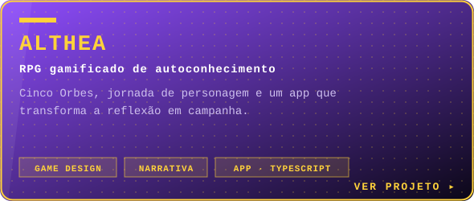
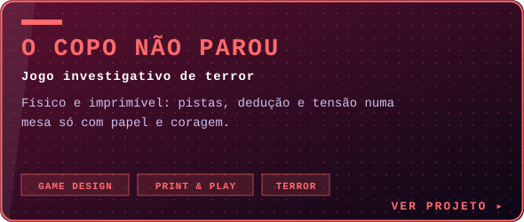
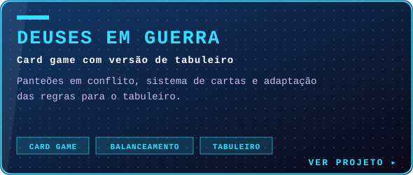
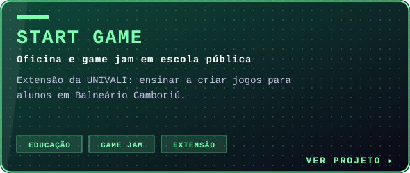
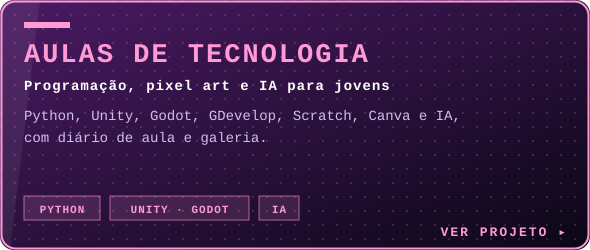
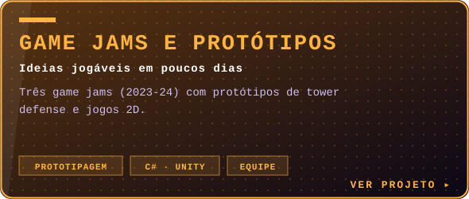

 

Eu desenho jogos e ensino quem quer aprender a fazer os seus. Estou no 7º período de Design de Jogos na UNIVALI, dou aula de programação, pixel art e IA para jovens na Super Geeks e crio sistemas, narrativas e interfaces que funcionam na mesa e na tela.

Estou buscando minha **primeira vaga em game design, com foco em trabalho remoto**. Se o seu estúdio precisa de alguém que pense em regras, conte histórias e consiga explicar o que construiu, vamos conversar.

Quer ver o trabalho completo, jogar ou conversar sobre uma vaga? O caminho mais rápido é o [portfólio](https://itallocunha.github.io), onde também está o [currículo em PDF](https://itallocunha.github.io/assets/curriculo-itallo-cunha.pdf).

